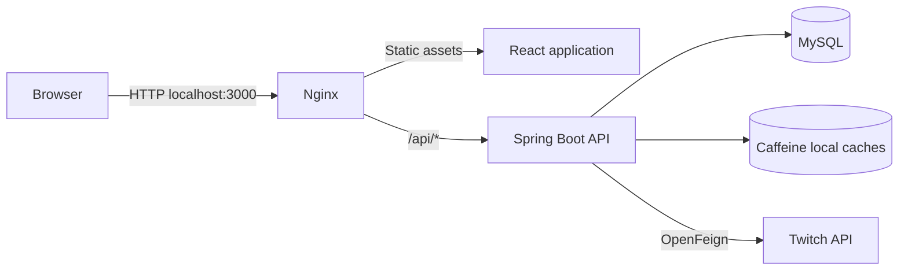

# StreamScope

[](https://github.com/abccdyk/streamscope/actions/workflows/ci.yml)

A full-stack Twitch discovery application built with Java, Spring Boot, and React. Browse popular games, search categories, explore live streams, and receive recommendations based on your saved games.

## Features

- Browse popular games and search Twitch categories with debounced input.
- Explore live streams by game and open channels on Twitch.
- Register and sign in with session-based authentication.
- Save and remove favorite games, with favorites isolated by authenticated user.
- Get live-stream recommendations with an explanation for each result.
- Reduce repeated Twitch API requests with bounded Caffeine caches.
- Run the frontend, backend, and database together with Docker Compose.
- Automatically test and build the application with GitHub Actions.

## Stack

| Layer | Technologies |
| --- | --- |
| Frontend | React, TypeScript, Vite |
| Backend | Java 21, Spring Boot 4.1, Spring Cloud OpenFeign |
| Authentication | Spring Security, BCrypt, HTTP sessions, CSRF protection |
| Persistence | MySQL 8.4, Spring Data JDBC, Flyway |
| Cache | Spring Cache, Caffeine |
| Testing | JUnit Jupiter, Mockito, Spring MockMvc |
| Packaging | Docker, Docker Compose, Nginx |
| CI | GitHub Actions |

## Architecture



The frontend uses relative `/api` URLs. Vite forwards these requests during local frontend development; Nginx forwards them in the container setup. Twitch credentials and application access tokens remain on the backend.

## Run with Docker Compose

### Prerequisites

- Git.
- Docker Engine and Docker Compose; Docker Desktop with Linux containers works on Windows.
- A registered confidential Twitch application with a Client ID and Client Secret.

Java and Node.js are supplied by the build images when using this setup.

### 1. Clone

```shell
git clone https://github.com/abccdyk/streamscope.git
cd streamscope
```

### 2. Configure environment variables

For a new checkout, create `.env` from `.env.example`:

```powershell
# Windows PowerShell
Copy-Item .env.example .env
```

```shell
# Linux / macOS
cp .env.example .env
```

If you already have a configured `.env`, retain it instead of running the copy command.

Set the values below in `.env`:

| Variable | Purpose |
| --- | --- |
| `MYSQL_ROOT_PASSWORD` | MySQL administrator password |
| `MYSQL_DATABASE` | Database name; use `streamscope` for the default setup |
| `MYSQL_USER` | Database application user; defaults to `streamscope` |
| `MYSQL_PASSWORD` | Database application user's password |
| `TWITCH_CLIENT_ID` | Twitch application Client ID |
| `TWITCH_CLIENT_SECRET` | Twitch application Client Secret |

Register the application using the [Twitch developer guide](https://dev.twitch.tv/docs/authentication/register-app/). The backend uses the Client Credentials flow. It does not require users to connect a Twitch account; users register separate StreamScope accounts.

Do not commit `.env`. Keep only placeholder values in `.env.example`.

### 3. Build and start

```shell
docker compose config --quiet
docker compose up -d --build
docker compose ps
```

Open **[http://localhost:3000](http://localhost:3000)**.

Compose waits for MySQL to become healthy before starting the backend, and waits for the backend health check before starting the frontend. Flyway applies database migrations on backend startup.

### 4. Logs and shutdown

```shell
docker compose logs --tail=100 backend
docker compose logs --tail=100 frontend
docker compose down
```

The `mysql_data` volume persists users and favorites across container restarts. `docker compose down -v` deletes that volume and its database contents.

MySQL's initialization variables only create credentials when the data directory is first initialized. Editing `.env` does not change passwords in an existing database.

## API overview

Public browsing:

| Method | Path | Purpose |
| --- | --- | --- |
| GET | `/api/health` | Basic application check |
| GET | `/api/games/top?first=12` | Popular games |
| GET | `/api/games/search?query=minecraft&first=12` | Search game categories |
| GET | `/api/streams?gameId=27471&first=12` | Live streams for a game |

Accounts and personalized features:

| Method | Path | Purpose |
| --- | --- | --- |
| GET | `/api/auth/csrf` | Obtain CSRF token and header name |
| POST | `/api/auth/register` | Register with a JSON username/password body |
| POST | `/api/auth/login` | Sign in with form-encoded username/password |
| GET | `/api/auth/me` | Get the authenticated user |
| POST | `/api/auth/logout` | End the session |
| GET | `/api/favorites/games` | List the current user's favorites |
| PUT | `/api/favorites/games/{gameId}` | Add a favorite idempotently |
| DELETE | `/api/favorites/games/{gameId}` | Remove a favorite idempotently |
| GET | `/api/recommendations` | Get recommendations for the current user |

Login returns a session cookie. API clients must retain that cookie and include the CSRF header on modifying requests, including registration, login, and logout. Fetch a new CSRF token after successful login and before further modifying requests. Successful favorite updates and logout return HTTP 204 without a response body.

## Recommendation rules

This version implements preference-based rules:

1. Read the authenticated user's favorites from MySQL.
2. Select up to five most recently saved games.
3. Retrieve up to four live streams per selected game.
4. Interleave streams across games, deduplicate by stream ID, and return at most 20 items.
5. Include a reason such as `因为你收藏了 Minecraft` with each item.

Users with no favorites receive popular live streams. If selected favorite games have no live streams, the personalized result may be empty. Upstream failures remain errors rather than being treated as successful empty results.

## Cache design

| Cache | Key inputs | TTL | Maximum entries |
| --- | --- | --- | --- |
| `topGames` | Requested count | 5 minutes | 100 |
| `gameSearch` | Search term and requested count | 5 minutes | 500 |
| `gameStreams` | Game ID and requested count | 30 seconds | 1,000 |
| `topStreams` | Requested count | 30 seconds | 100 |

Spring Cache uses the method arguments as keys. Caffeine coordinates concurrent loads for the same key with `sync = true`. Failed method executions are not stored as successful results.

Favorites and final personalized recommendation responses are not cached. Each recommendation request rereads favorites and assembles its result using public stream-query caches. This keeps preference changes visible immediately while allowing stream metadata to be up to approximately 30 seconds old.

## Authentication and external API behavior

- Passwords are stored as BCrypt hashes; API responses do not include them.
- Usernames are normalized to lowercase. A database unique constraint prevents duplicates.
- Favorite operations use the authenticated principal, not a user ID supplied by the client.
- The database enforces uniqueness of `(user_id, twitch_game_id)`.
- Website sessions and Twitch application tokens have separate lifecycles.
- Twitch application tokens are reused and renewed before their expected expiration.
- A Twitch content request returning 401 invalidates the rejected token and retries once with a current token. Other failures are not retried by this executor.
- A late rejection of an older token does not invalidate an already replaced token.
- Expected API errors use `{ "code": "...", "message": "..." }`. Twitch authorization failures become upstream errors, rather than website login failures.

## Tests and CI

With Java 21 installed, run the isolated error-handling and token tests from `backend`:

```powershell
.\mvnw.cmd "-Dtest=GlobalExceptionHandlerTest,TwitchRequestExecutorTest" test
```

On Linux/macOS, use `./mvnw` instead of `.\mvnw.cmd`.

These tests use simulated requests and do not require a real Twitch account or database. They cover bounded token retries, error status mapping, request validation, and protection against stale token invalidation.

The complete backend test suite also includes an application-context startup test. Running `verify` locally requires a reachable MySQL database and the backend configuration variables (`DB_URL`, `DB_USERNAME`, `DB_PASSWORD`, `TWITCH_CLIENT_ID`, `TWITCH_CLIENT_SECRET`). Spring Boot does not automatically load the root Compose `.env` file.

Frontend checks, from `frontend`:

```shell
npm ci
npm run lint
npm run build
```

The [CI workflow](.github/workflows/ci.yml) runs on pushes and pull requests. It provisions a disposable MySQL service for backend verification, runs frontend checks, and then builds both Docker images. CI uses placeholder Twitch credentials for context startup and simulated responses for external API tests.

## Current deployment scope

The documented deployment is local Docker Compose. Sessions and Caffeine caches are process-local: restarting the backend clears sessions and caches but retains users and favorites in MySQL.

AWS deployment is planned using ECR, ECS Fargate, and RDS. Production HTTPS, secret injection, and network configuration are deployment work still to be completed. Multiple backend instances would additionally require a shared-session strategy and an explicit cache-consistency design.
